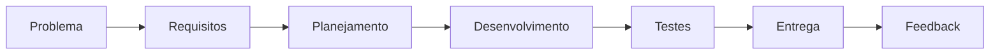
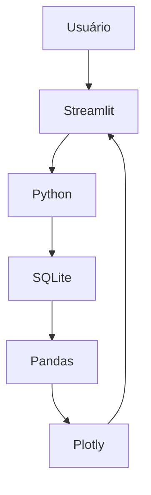

# Fábrica de Software — MVP de Controle de Estoque

Projeto acadêmico desenvolvido pelo grupo **Formalizando**, do curso de **Análise e Desenvolvimento de Sistemas — UNINASSAU Paulista/PE**, com o objetivo de apresentar, de forma prática, como funciona uma **Fábrica de Software**.

O projeto utiliza como estudo de caso o desenvolvimento de um **MVP (Produto Mínimo Viável) de Controle de Estoque**, demonstrando como um problema real pode ser transformado em requisitos, desenvolvimento, armazenamento de dados, testes, indicadores e apresentação de resultados.

---

## 1. Contexto do Projeto

A proposta foi criada para uma atividade de intervenção acadêmica voltada a estudantes do Ensino Médio da **EREM Professora Amarina Simões**, em Paulista/PE.

O foco da apresentação é mostrar que o desenvolvimento de software não se resume apenas à programação. Uma Fábrica de Software envolve:

- pessoas;
- levantamento de requisitos;
- planejamento;
- prototipação;
- desenvolvimento;
- banco de dados;
- testes;
- análise dos dados;
- apresentação dos resultados;
- feedback.

O sistema de controle de estoque foi escolhido como exemplo por representar um problema comum de pequenos comércios.

---

## 2. Equipe

O grupo acadêmico é composto por 6 integrantes:

- Ikaro Guilherme
- Mayra Rosa
- Ana Clara Borges
- José Wallisson
- Pedro José
- Thayanne Victoria

### Divisão proposta das responsabilidades

| Integrante | Responsabilidade principal |
|---|---|
| Ikaro Guilherme | Gestão do projeto / Product Owner |
| Mayra Rosa | Requisitos e documentação |
| Ana Clara Borges | UX/UI e prototipação |
| José Wallisson | Desenvolvimento Python / regras de negócio |
| Pedro José | Banco de dados e análise de dados |
| Thayanne Victoria | Testes / qualidade e avaliação |

> Como a equipe é pequena, as funções podem ser colaborativas e um integrante pode apoiar mais de uma etapa.

---

## 3. Problema Identificado

O estudo de caso considera um pequeno comércio que precisa controlar seus produtos e enfrenta dificuldades como:

- não saber com precisão quanto possui em estoque;
- acompanhar entradas de produtos;
- acompanhar saídas de produtos;
- consultar o saldo atual;
- visualizar o histórico das movimentações;
- transformar os dados armazenados em informações úteis.

A partir desse problema foi definido o MVP do projeto.

---

## 4. Fluxo Simplificado da Fábrica de Software



Esse fluxo representa de forma simplificada o processo utilizado no projeto.

---

## 5. Definição do MVP

O MVP foi definido com foco apenas nas funcionalidades essenciais necessárias para demonstrar o controle de estoque.

### Requisitos funcionais

#### RF01 — Cadastro de Produtos

Permite cadastrar um produto informando:

- nome;
- quantidade inicial.

O produto é armazenado no banco de dados SQLite.

#### RF02 — Entrada de Estoque

Permite selecionar um produto cadastrado e registrar uma entrada.

Ao registrar uma entrada:

- a quantidade do produto aumenta;
- a movimentação é armazenada no banco de dados.

#### RF03 — Saída de Estoque

Permite selecionar um produto cadastrado e registrar uma saída.

Ao registrar uma saída:

- a quantidade do produto diminui;
- a movimentação é armazenada no banco de dados;
- o sistema impede uma saída maior que o saldo disponível.

#### RF04 — Consulta do Saldo Disponível

Permite consultar os produtos cadastrados e visualizar a quantidade atualmente disponível de cada item.

#### RF05 — Histórico de Movimentações

Exibe as movimentações realizadas no sistema, contendo:

- ID;
- produto;
- tipo da movimentação;
- quantidade;
- data e hora.

Tipos utilizados:

```text
ENTRADA
SAÍDA
```

#### RF06 — Dashboard / Indicadores

Apresenta informações derivadas dos dados armazenados no sistema.

Indicadores implementados:

- produtos cadastrados;
- unidades em estoque;
- total de entradas;
- total de saídas.

Gráficos implementados:

- quantidade atual por produto;
- movimentações por tipo.

---

## 6. Tecnologias Utilizadas

| Tecnologia | Utilização |
|---|---|
| Python | Linguagem principal |
| Streamlit | Interface web |
| SQLite | Banco de dados |
| Pandas | Tratamento e análise dos dados |
| Plotly | Gráficos e indicadores |

### Recursos complementares previstos no projeto

- Excel / CSV
- Power BI

Esses recursos podem ser utilizados para exportação e visualização complementar dos dados.

---

## 7. Arquitetura do MVP



### Responsabilidades

**Streamlit**
- interface;
- formulários;
- abas;
- exibição de tabelas;
- exibição dos gráficos.

**Python**
- regras do sistema;
- validações;
- comunicação entre interface e banco.

**SQLite**
- produtos;
- movimentações;
- saldo atual.

**Pandas**
- organização e tratamento dos dados.

**Plotly**
- construção dos gráficos do dashboard.

---

## 8. Estrutura do Projeto

```text
fabrica_software/
│
├── app.py
├── database.py
├── requirements.txt
├── README.md
├── estoque.db
├── .gitignore
└── .venv/
```

### Arquivos principais

#### `app.py`

Responsável pela interface do sistema em Streamlit.

Contém:

- cadastro;
- entrada;
- saída;
- consulta;
- histórico;
- dashboard.

#### `database.py`

Responsável pela comunicação com o SQLite.

Contém as funções de:

- inicialização do banco;
- cadastro;
- consulta de produtos;
- registro de entrada;
- registro de saída;
- consulta do histórico.

#### `requirements.txt`

Dependências necessárias:

```text
streamlit
pandas
plotly
```

#### `estoque.db`

Banco SQLite gerado localmente pelo sistema.

No repositório GitHub, o banco pode ser ignorado pelo `.gitignore` para evitar o envio de dados de teste.

---

## 9. Banco de Dados

Foram utilizadas duas tabelas principais.

### Tabela `produtos`

| Campo | Função |
|---|---|
| id | Identificador único |
| nome | Nome do produto |
| quantidade | Quantidade atual |

### Tabela `movimentacoes`

| Campo | Função |
|---|---|
| id | Identificador da movimentação |
| produto_id | Produto relacionado |
| tipo | ENTRADA ou SAÍDA |
| quantidade | Quantidade movimentada |
| data_hora | Data e hora da operação |

---

## 10. Etapas de Desenvolvimento

### Etapa 1 — Estrutura inicial

Foram criados:

- `app.py`;
- `database.py`;
- `requirements.txt`;
- `README.md`;
- banco SQLite inicial.

Objetivo:

```powershell
python -m streamlit run app.py
```

Resultado:

- aplicação Streamlit executando no navegador;
- conexão inicial com SQLite funcionando.

### Etapa 2 — RF01: Cadastro

Implementação do cadastro de produtos.

Teste realizado:

```text
Produto: Esteira De Carro
Quantidade inicial: 20
```

O produto foi armazenado e exibido corretamente.

### Etapa 3 — RF02: Entrada

Foi adicionada a aba:

```text
Entrada de Estoque
```

O sistema passou a:

- selecionar produto;
- informar quantidade;
- somar ao saldo;
- registrar a movimentação.

### Etapa 4 — RF03: Saída

Foi adicionada a aba:

```text
Saída de Estoque
```

Validações implementadas:

- não permitir saída acima do estoque;
- atualizar saldo;
- registrar movimentação.

O bloqueio de estoque negativo foi validado durante os testes.

### Etapa 5 — RF04: Consulta

Foi adicionada a aba:

```text
Consulta de Estoque
```

Ela exibe:

- ID;
- produto;
- quantidade disponível.

### Etapa 6 — RF05: Histórico

Foi adicionada a aba:

```text
Histórico
```

Ela exibe todas as movimentações registradas.

### Etapa 7 — RF06: Dashboard

Foi adicionada a aba:

```text
Dashboard
```

Indicadores:

```text
Produtos cadastrados
Unidades em estoque
Total de entradas
Total de saídas
```

Gráficos:

```text
Quantidade atual por produto
Movimentações por tipo
```

Também foi realizado um ajuste visual nas barras dos gráficos para reduzir a largura e melhorar a apresentação.

Exemplo:

```python
grafico_estoque.update_layout(
    bargap=0.60
)
```

---

## 11. Testes Realizados

Após a implementação dos requisitos, foi realizado um fluxo completo de validação.

### Cenário de teste

Foi utilizado um segundo produto:

```text
Guaraná 2 Litros
```

Fluxo testado:

1. cadastro;
2. entrada;
3. saída;
4. bloqueio de saída acima do saldo;
5. consulta;
6. histórico;
7. dashboard.

Os dados apareceram corretamente em todas as áreas.

---

## 12. Execução do Projeto

### Pré-requisitos

Ter o Python instalado.

### Criar ambiente virtual

```powershell
py -m venv .venv
```

### Ativar no PowerShell

```powershell
.\.venv\Scripts\Activate.ps1
```

Caso o PowerShell bloqueie a execução:

```powershell
Set-ExecutionPolicy -Scope Process -ExecutionPolicy Bypass
```

Depois:

```powershell
.\.venv\Scripts\Activate.ps1
```

### Instalar dependências

```powershell
python -m pip install -r requirements.txt
```

### Executar

```powershell
python -m streamlit run app.py
```

A aplicação será aberta no navegador, normalmente em:

```text
http://localhost:8501
```

---

## 13. `.gitignore`

Configuração recomendada no projeto:

```gitignore
.venv/
__pycache__/
*.pyc
.env
.vscode/
.idea/
estoque.db
```

Isso impede que arquivos locais ou desnecessários sejam enviados ao repositório.

---

## 14. Versionamento com Git

O projeto foi inicializado com:

```powershell
git init
```

Arquivos adicionados:

```powershell
git add .
```

Primeiro commit:

```powershell
git commit -m "feat: MVP inicial do sistema de controle de estoque"
```

Branch principal:

```powershell
git branch -M main
```

Conexão com GitHub:

```powershell
git remote add origin URL_DO_REPOSITORIO
```

Envio:

```powershell
git push -u origin main
```

Fluxo para alterações futuras:

```powershell
git add .
git commit -m "descrição da alteração"
git push
```

---

## 15. Apresentação Acadêmica

Foi criada uma apresentação com 12 slides.

Estrutura:

1. Fábrica de Software
2. O que é uma Fábrica de Software?
3. O Problema
4. Do Problema para a Solução
5. Levantamento de Requisitos
6. Como o Sistema foi Construído
7. Nosso MVP
8. Demonstração Prática
9. O Dashboard
10. Quem Participa de uma Fábrica de Software?
11. Agora é a Vez de Vocês
12. Encerramento

A apresentação foi planejada para aproximadamente **30 minutos**.

A condução principal será realizada por **1 integrante**.

---

## 16. Demonstração ao Vivo

Durante a apresentação, o MVP pode ser demonstrado na seguinte ordem:

```text
Cadastrar produto
        ↓
Registrar entrada
        ↓
Registrar saída
        ↓
Consultar estoque
        ↓
Ver histórico
        ↓
Visualizar Dashboard
```

---

## 17. Dinâmica com os Alunos

A apresentação inclui uma etapa participativa.

Perguntas propostas:

```text
Que funcionalidade vocês adicionariam a esse sistema?
```

e:

```text
Que outro problema do dia a dia poderia ser resolvido através de um software?
```

---

## 18. Formulário de Avaliação

Foi criado um formulário no Google Forms para avaliar a intervenção.

### Questão 1

**O que melhor representa uma Fábrica de Software?**

Resposta correta:

```text
Um processo organizado que envolve pessoas, etapas, processos e tecnologias para desenvolver software.
```

### Questão 2

**Qual foi o problema utilizado como exemplo na apresentação?**

Resposta correta:

```text
Controle de estoque de um pequeno comércio.
```

### Questão 3

**O que significa MVP no contexto apresentado?**

Resposta correta:

```text
Uma primeira versão funcional com apenas as funcionalidades essenciais.
```

### Questão 4

Pergunta aberta:

```text
Que funcionalidade você adicionaria ao sistema de controle de estoque ou que outro problema do dia a dia você acha que poderia ser resolvido com um software?
```

### Questão 5

Avaliação da atividade:

```text
1 — Muito ruim
2
3
4
5 — Muito boa
```

---

## 19. Indicadores de Avaliação da Intervenção

| Indicador | Meta |
|---|---|
| Participação | 10 a 15 estudantes |
| Compreensão | Pelo menos 80% acertando 2 de 3 questões |
| Engajamento | Aproximadamente 70% de participação ativa |
| Proposição de soluções | Pelo menos 3 sugestões relevantes |
| Satisfação | Média igual ou superior a 4,0 |

---

## 20. Status do Projeto

| Etapa | Status |
|---|---|
| Documento acadêmico | Concluído |
| Definição do MVP | Concluído |
| Requisitos funcionais | Concluído |
| Estrutura técnica | Concluído |
| Cadastro | Concluído |
| Entrada | Concluído |
| Saída | Concluído |
| Consulta | Concluído |
| Histórico | Concluído |
| Dashboard | Concluído |
| Testes | Concluído |
| Ajustes visuais | Concluído |
| Slides | Concluído |
| Google Forms | Concluído |
| Repositório GitHub | Em publicação / versionamento |
| Intervenção na escola | Pendente |
| Consolidação dos resultados | Pendente |

---

## 21. Próximas Etapas

1. finalizar o roteiro de fala do apresentador;
2. revisar a dinâmica;
3. realizar ensaio cronometrado;
4. testar o MVP no notebook que será utilizado;
5. validar projetor/televisão e internet;
6. realizar a intervenção;
7. coletar respostas do Google Forms;
8. consolidar os resultados;
9. finalizar a entrega acadêmica.

---

## 22. Objetivo Final

O objetivo principal do projeto não é apenas demonstrar um sistema de estoque.

O MVP funciona como uma ferramenta didática para mostrar aos estudantes que um software nasce de um processo organizado:

```text
Problema
↓
Análise
↓
Requisitos
↓
Planejamento
↓
Desenvolvimento
↓
Testes
↓
Entrega
↓
Avaliação
```

Dessa forma, o projeto aproxima os alunos do Ensino Médio da área de Tecnologia da Informação e apresenta, de maneira prática, como diferentes conhecimentos e profissionais participam da construção de uma solução de software.

---

## 23. Instituição

**UNINASSAU Paulista - PE**  
Curso: **Análise e Desenvolvimento de Sistemas**  
Projeto: **Fábrica de Software**  
Grupo: **Formalizando**

---

## 24. Licença

Este projeto foi desenvolvido para fins acadêmicos e educacionais.
